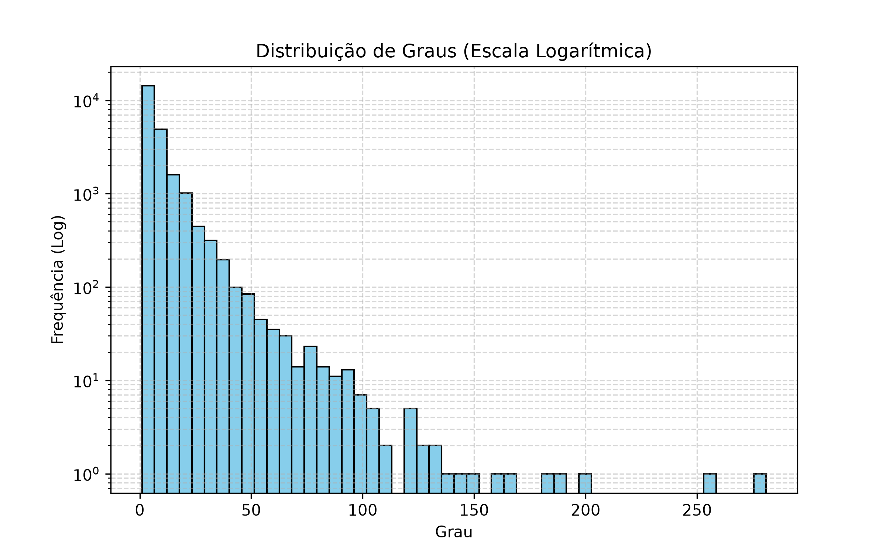
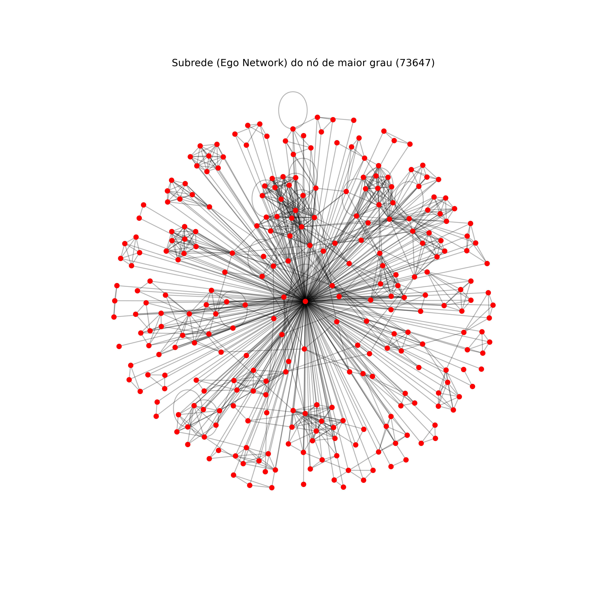
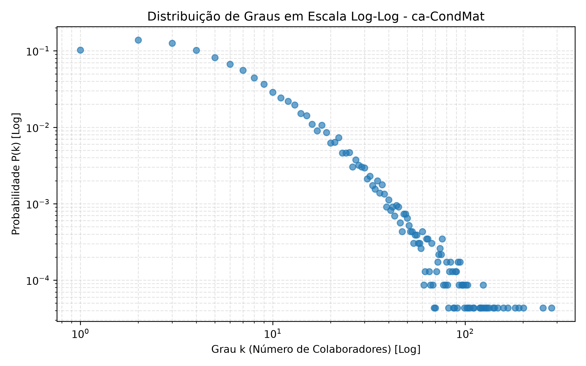

# Análise Estrutural, Algorítmica e Topológica da Rede `ca-CondMat`

Repositório dedicado ao trabalho prático da disciplina de **Teoria dos Grafos** (Universidade Federal da Bahia — UFBA), apresentando a caracterização estrutural, avaliação empírica de algoritmos e análise de propriedades topológicas da rede de colaboração científica **ca-CondMat**.

---

## Sobre o Conjunto de Dados

O grafo analisado pertence à coleção *Collaboration Networks* do repositório **Stanford Network Analysis Project (SNAP)** e representa coautorias científicas na área de Física da Matéria Condensada (*Condensed Matter Physics*).

* **Fonte:** [SNAP — ca-CondMat](https://snap.stanford.edu/data/ca-CondMat.html)
* **Tipo de Grafo:** Não direcionado e originalmente não ponderado
* **Vértices ($\lvert V \rvert$):** $23.133$ pesquisadores
* **Arestas ($\lvert E \rvert$):** $93.497$ colaborações (coautorias)

---

## Estrutura do Repositório

```text
tp-grafos/
├── analise_ca_condmat.ipynb   # Notebook Jupyter com todas as análises, métricas e algoritmos
├── CA-CondMat.txt             # Lista de arestas do grafo obtida do repositório SNAP
├── distribuicao_graus.png     # Histograma da distribuição de graus em escala logarítmica
├── visualizacao_reduzida.png  # Subrede reduzida (Ego Network) do vértice de maior grau
├── lei_potencia.png           # Análise da distribuição de graus em escala log-log
└── README.md                  # Documentação do projeto
```

---

## Resultados Principais

### Parte I — Análise Estrutural

Devido à existência de componentes desconectadas, as métricas de distância (diâmetro, raio e comprimento médio dos caminhos) foram computadas sobre a **Maior Componente Conexa (LCC)**, que concentra 92,35% dos vértices da rede.

| Métrica Estrutural | Valor Obtido | Escopo |
| :--- | :---: | :--- |
| **Número de Vértices ($\lvert V \rvert$)** | $23.133$ | Grafo completo |
| **Número de Arestas ($\lvert E \rvert$)** | $93.497$ | Grafo completo |
| **Grau Mínimo ($k_{\min}$)** | $1$ | Grafo completo |
| **Grau Máximo ($k_{\max}$)** | $281$ | Vértice *hub* (ID `73647`) |
| **Grau Médio ($\langle k \rangle$)** | $8,0834$ | Grafo completo |
| **Densidade ($D$)** | $0,000349$ | Grafo completo |
| **Componentes Conexas** | $567$ | Grafo completo |
| **Maior Componente Conexa (LCC)** | $21.363$ | Componente principal |
| **Cinco Maiores Componentes** | `[21363, 21, 17, 15, 15]` | Grafo completo |
| **Diâmetro** | $15$ | Maior Componente Conexa (LCC) |
| **Raio** | $8$ | Maior Componente Conexa (LCC) |
| **Comprimento Médio dos Caminhos ($L$)** | $5,3522$ | Maior Componente Conexa (LCC) |
| **Coeficiente de Clusterização Médio ($C$)** | $0,6334$ | Grafo completo |
| **Número de Triângulos** | $173.361$ | Grafo completo |

#### Visualizações Estruturais

| Distribuição de Graus (Escala Logarítmica) | Ego Network do Hub Principal (`73647`) |
| :---: | :---: |
|  |  |

---

### Parte II — Complexidade Teórica e Desempenho dos Algoritmos

Para algoritmos de caminho mínimo ponderado (Dijkstra e Bellman-Ford), atribuiu-se peso unitário ($w = 1,0$) às arestas. A Árvore Geradora Mínima (AGM) foi executada sobre a LCC, e o algoritmo de Floyd-Warshall ($O(V^3)$) foi avaliado em um subgrafo amostral de $N = 100$ vértices.

| Algoritmo | Aplicável | Complexidade Teórica | Média (s) | Desvio Padrão (s) | IC 95% (s) |
| :--- | :---: | :---: | :---: | :---: | :---: |
| **Busca em Largura (BFS)** | Sim | $O(V + E)$ | $0,060565$ | $0,032343$ | $[0,037428;\, 0,083702]$ |
| **Busca em Profundidade (DFS)** | Sim | $O(V + E)$ | $0,046615$ | $0,021579$ | $[0,031178;\, 0,062052]$ |
| **Verificação de Eulerianidade** | Sim | $O(V + E)$ | $0,029250$ | $0,004303$ | $[0,026172;\, 0,032328]$ |
| **Dijkstra (Single Source)** | Sim ($w=1$) | $O((V+E)\log V)$ | $0,099670$ | $0,001486$ | $[0,098607;\, 0,100732]$ |
| **Bellman-Ford (Single Source)** | Sim ($w=1$) | $O(V \cdot E)$ | $0,153449$ | $0,047277$ | $[0,036007;\, 0,270891]$ |
| **Floyd-Warshall** | Não ($N=100$) | $O(V^3)$ | $0,001765$ | $0,000484$ | $[0,001164;\, 0,002367]$ |
| **Tarjan (Pontos de Articulação)** | Sim | $O(V + E)$ | $0,098846$ | $0,014358$ | $[0,088575;\, 0,109117]$ |
| **AGM (Kruskal / Prim)** | Sim (LCC) | $O(E \log V)$ | $0,274911$ | $0,052352$ | $[0,237461;\, 0,312361]$ |

---

### Parte III — Análise Topológica Avançada

* **Propriedade Small-World:** A rede apresenta coeficiente de clusterização médio ($C = 0,6334$) mais de três ordens de grandeza superior ao de um grafo aleatório equivalente, mantendo um comprimento médio de caminhos curto ($L = 5,3522$). Isso reflete grupos de pesquisa altamente coesos interligados por pesquisadores que atuam como pontes entre instituições.
* **Lei de Potência (Scale-Free):** A distribuição de graus em escala log-log exibe comportamento decrescente característico de redes livres de escala, explicado pelo fenômeno de **ligação preferencial**, no qual novos pesquisadores tendem a colaborar com autores já consolidados (*hubs*).
* **Robustez e Vulnerabilidade:** A rede é altamente resiliente à remoção aleatória de 5% dos vértices (preservando a LCC), mas sofre fragmentação severa diante da remoção direcionada dos 5% vértices mais centrais.
* **Aderência a Modelos Clássicos:** A topologia combina características do **Modelo de Barabási-Albert** (crescimento com ligação preferencial e cauda longa) e do **Modelo de Watts-Strogatz** (alta transitividade local e caminhos curtos).



---

## Como Executar o Projeto

1. Clone este repositório:
   ```bash
   git clone [https://github.com/biatrixsz/tp-grafos.git](https://github.com/biatrixsz/tp-grafos.git)
   cd tp-grafos
   ```
2. Instale as dependências necessárias:
   ```bash
   pip install networkx numpy matplotlib scipy jupyter
   ```
3. Abra e execute o notebook `analise_ca_condmat.ipynb`:
   ```bash
   jupyter notebook analise_ca_condmat.ipynb
   ```

---

## Autoria

* **Beatriz Mendes Rios** — Universidade Federal da Bahia (UFBA)
